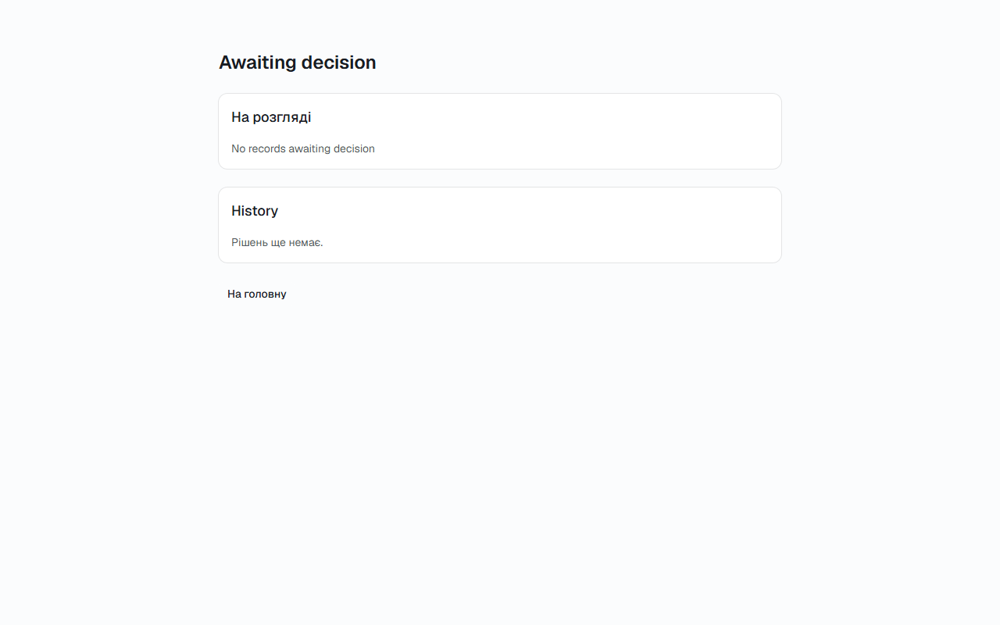

# Звіт UAT — 03.11.2026

- **Застосунок:** https://course-staff-management.vercel.app (/api/health: коміт `8bbc7ec`)
- **Код тестів:** `task/uat-prod` @ `8bbc7ec` + незакомічені зміни
- **Прогін:** 03.11.2026, 12:45 (Київ), Playwright 30.9 с; AC: 3 — PASS 0, FAIL 2, NEEDS-HUMAN 1
- **Рецензент:** `claude-haiku-5-5`; суперечки → `claude-sonnet-5-5`. Разом за розбір: $0.0382 (ціни API; за підпискою — у межах ліміту плану)
- **Прибирання:** синтетичних uat-*@example.test видалено 0, лишилось 0, їхніх рядків, що лишились: 0
- **Відео й траси:** не в git — `test-results/` локально або артефакт CI; трасу відкриває `npx playwright show-trace <trace.zip>`

| AC | Перевірки | Агент | Підсумок | Чому | Playwright | Розбір |
|---|---|---|---|---|---|---|
| AC-BALANCE-13 | впали | Haiku: NEEDS-HUMAN | **FAIL** | R1: перевірка впала — FAIL завжди, агент не перекриває | 0.5 с | $0.0019, 10.5 с |
| AC-DECIDE-04 | впали | Haiku: NEEDS-HUMAN | **FAIL** | R1: перевірка впала — FAIL завжди, агент не перекриває | 7.0 с | $0.0020, 9.7 с |
| AC-DECIDE-14 | пройшли | Haiku: NEEDS-HUMAN, Sonnet: NEEDS-HUMAN | **NEEDS-HUMAN** | R3: перевірки пройшли, агент не погоджується — вирішує людина | 4.5 с | $0.0343, 21.0 с |

## AC-BALANCE-13 — FAIL

**Тест:** AC-BALANCE-13: працівник відкриває чужі залишки за прямим посиланням — чисел не бачить

**Критерій** (requirements/03-leave-balance.md):

> AC-BALANCE-13: Given employee teacher1@example.test. When teacher1@example.test tries to view another employee's balances. Then the balances are not shown.


**Кроки:** ✘ Дано: працівник teacher1@example.test — у порталі, і він не менеджер жодної посади teacher2@example.test

**Перевірка впала:**

```
Error: задайте UAT_OTHER_EMPLOYEE_ID — id teacher2@example.test у profiles (беремо з .env.local, у репо не зберігаємо)

expect(received).toBeTruthy()

Received: undefined
```

**Агент (claude-haiku-5-5, NEEDS-HUMAN):** Жодного кадру я не побачив, тому нічого не можу підтвердити чи спростувати щодо частини «Тоді». Щоб продовжити, потрібно дозволити читання цих трьох файлів (або запустити рецензію з повним шляхом без короткого імені DEVELO~1) і повторити перевірку. Я не обходив обмеження альтернативними шляхами.

**Агент бачить вади:**
- Доступ до ac.md, journey.md і frame-then-1.png заблоковано системою дозволів: шлях C:\Users\DEVELO~1\... містить короткe ім'я DEVELO~1, і читання вимагає ручного підтвердження, якого в цій сесії немає. Жоден файл не прочитано, тому критерій і кадри не перевірено.

**Правило:** R1: перевірка впала — FAIL завжди, агент не перекриває

**Відео:** `test-results/artifacts/balances-forbidden-AC-BALA-48372-осиланням-—-чисел-не-бачить-chromium/video.webm` · **траса:** `test-results/artifacts/balances-forbidden-AC-BALA-48372-осиланням-—-чисел-не-бачить-chromium/trace.zip` (не в git)

**Рішення PM:** ☐ приймаю · ☐ відхилення від вимог (issue «Відхилення від вимог: AC-BALANCE-13 — …») · @login: ____

## AC-DECIDE-04 — FAIL

**Тест:** AC-DECIDE-04: менеджер повертає запис без коментаря — статус не змінюється, видно «Tell the employee what to fix»

**Критерій** (requirements/02-leave-decision.md):

> AC-DECIDE-04: Given a record with status "Awaiting decision". When the manager returns it for revision without a comment. Then the status does not change, and the manager sees the message "Tell the employee what to fix".


**Кроки:** ✘ Дано: у менеджера manager1@example.test є запис зі статусом «Awaiting decision»

**Перевірка впала:**

```
Error: expect(locator).toBeVisible() failed

Locator: getByText('2027-11-08')
Expected: visible
Timeout: 5000ms
Error: element(s) not found

Call log:
```

**Агент (claude-haiku-5-5, NEEDS-HUMAN):** Жоден із трьох файлів не вдалося прочитати, тому я не бачив ні критерію, ні кадрів. Я не намагався обійти перевірку шляху (наприклад, іншою формою шляху), бо дозвіл був відхилений автоматично і повторювати його не можна. Щоб завершити рецензію, потрібно або погодити читання цих файлів вручну, або перезапустити перевірку з шляхом без короткого імені DEVELO~1.

**Агент бачить вади:**
- Доступ до ac.md, journey.md і frame-then-*.png заблоковано системою дозволів: шлях C:\Users\DEVELO~1\AppData\Local\Temp\uat-review-5MZRr2 містить короткe ім'я (DEVELO~1), що позначено як підозрілий шаблон. Запит потребує ручного погодження, а в цій сесії погодження неможливе.
- Через це не відомо, які частини «Тоді» треба перевірити, і кадри не переглянуто. Жодних висновків про відповідність критерію не зроблено.

**Правило:** R1: перевірка впала — FAIL завжди, агент не перекриває

**Відео:** `test-results/artifacts/decisions-return-no-commen-942cb-l-the-employee-what-to-fix»-chromium/video.webm` · **траса:** `test-results/artifacts/decisions-return-no-commen-942cb-l-the-employee-what-to-fix»-chromium/trace.zip` (не в git)

**Рішення PM:** ☐ приймаю · ☐ відхилення від вимог (issue «Відхилення від вимог: AC-DECIDE-04 — …») · @login: ____

## AC-DECIDE-14 — NEEDS-HUMAN

**Тест:** AC-DECIDE-14: менеджер без записів на розгляді бачить «No records awaiting decision»

**Критерій** (requirements/02-leave-decision.md):

> AC-DECIDE-14: Given the manager has 0 records with status "Awaiting decision". When the manager opens the "Awaiting decision" list. Then the manager sees the message "No records awaiting decision".



**Кроки:** ✔ Дано: менеджер manager2@example.test — у порталі, записів на розгляді в нього немає → ✔ Коли: відкриває список «Awaiting decision» → ✔ Тоді: бачить повідомлення «No records awaiting decision», і жодного запису в списку немає

**Агент (claude-sonnet-5-5, NEEDS-HUMAN):** Я не прочитав жодного файлу, тому не можу оцінити критерій. Щоб повторити перевірку, потрібен дозвіл на читання цієї теки або повний шлях без скорочених імен 8.3.

Haiku сказав NEEDS-HUMAN, тож розбір повторив Sonnet; рішення агента — за Sonnet.

**Агент бачить вади:**
- Читання ac.md і journey.md заблоковано: шлях у короткому форматі Windows (DEVELO~1) вимагає ручного схвалення, а в цій сесії немає кому його дати.
- Кадри frame-then-*.png не відкривались, бо без ac.md невідомо, які саме частини «Тоді» перевіряти.

**Правило:** R3: перевірки пройшли, агент не погоджується — вирішує людина

**Відео:** `test-results/artifacts/decisions-empty-AC-DECIDE--62fd7--records-awaiting-decision»-chromium/video.webm` · **траса:** `test-results/artifacts/decisions-empty-AC-DECIDE--62fd7--records-awaiting-decision»-chromium/trace.zip` (не в git)

**Рішення PM:** ☐ приймаю · ☐ відхилення від вимог (issue «Відхилення від вимог: AC-DECIDE-14 — …») · @login: ____

## Як читати підсумок

- **PASS** — автоматичні перевірки пройшли, агент-рецензент погодився з кадром, а кожну його цитату знайдено на сторінці.
- **FAIL** — впала автоматична перевірка. Агент цього не перекриває: невидимі вади (буфер обміну, база) він на кадрі не побачить.
- **NEEDS-HUMAN** — перевірки зелені, але агент не погодився або його цитати немає на сторінці. Часто це слабкий тест або розбіжність між текстом AC і тестом — питання до PM, а не обов'язково вада продукту.

Правила: R1: перевірка впала — FAIL завжди, агент не перекриває; R2: немає вердикту агента або кадру; R3: перевірки пройшли, агент не погоджується — вирішує людина; R4: цитати агента немає на сторінці (aria) — не підтверджено; R5: помилка сторінки або 5xx під час сценарію; R6: перевірки, агент і цитати збігаються.
