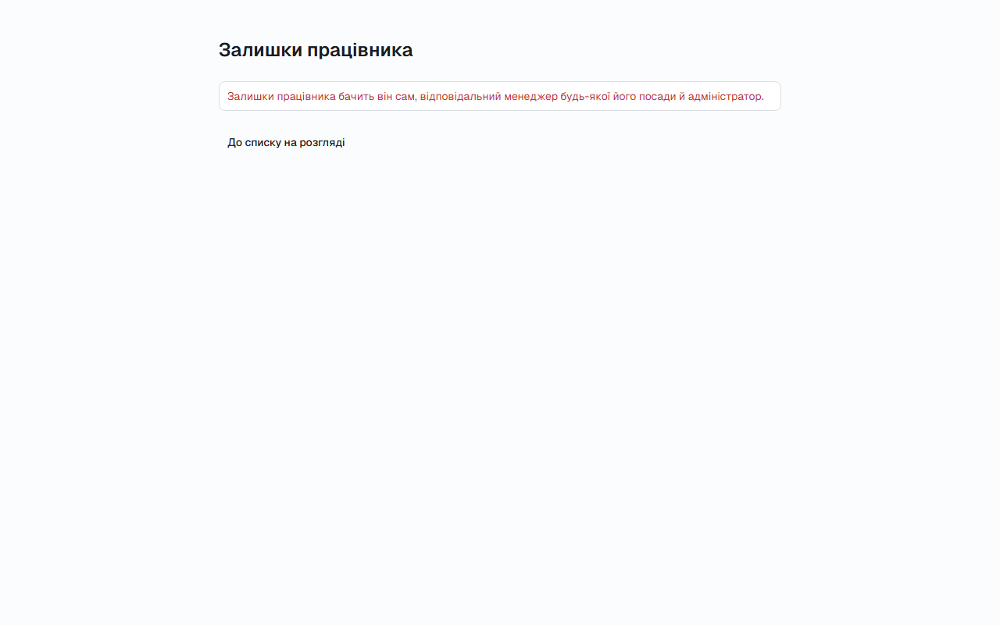
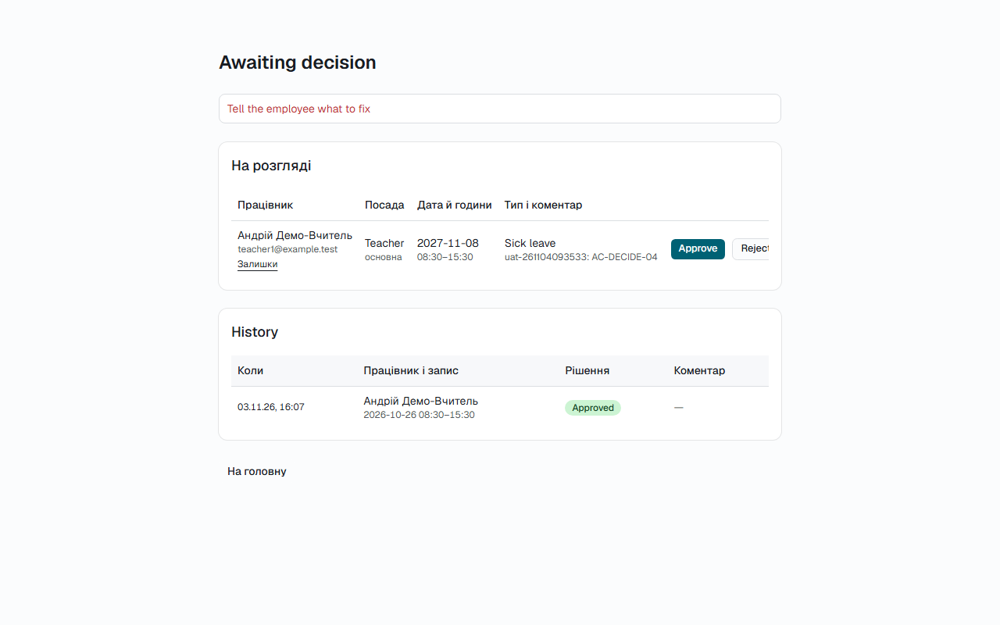
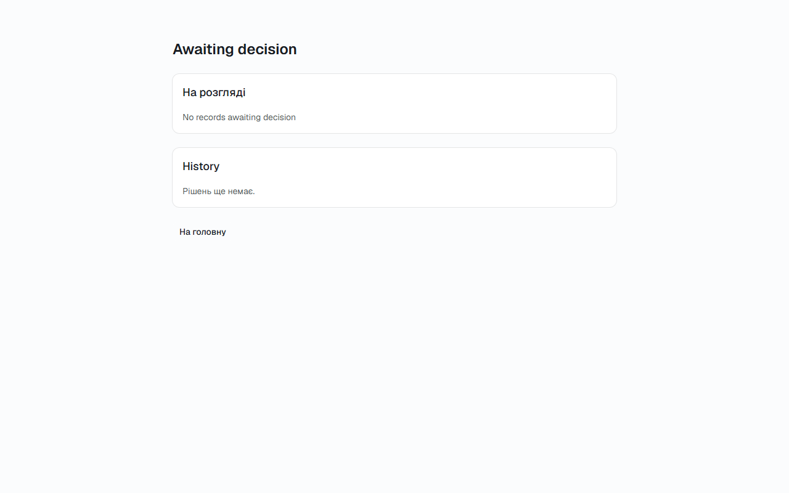

# Звіт UAT — 04.11.2026

- **Застосунок:** https://course-staff-management.vercel.app (/api/health: коміт `680921b`)
- **Код тестів:** `main` @ `680921b`
- **Прогін:** 04.11.2026, 11:35 (Київ), Playwright 33.9 с; AC: 3 — PASS 3, FAIL 0, NEEDS-HUMAN 0
- **Рецензент:** `claude-haiku-5-5`; суперечки → `claude-sonnet-5-5`. Разом за розбір: $0.0056 (ціни API; за підпискою — у межах ліміту плану)
- **Прибирання:** синтетичних uat-*@example.test видалено 0, лишилось 0, їхніх рядків, що лишились: 0
- **Відео й траси:** не в git — `test-results/` локально або артефакт CI; трасу відкриває `npx playwright show-trace <trace.zip>`

| AC | Перевірки | Агент | Підсумок | Чому | Playwright | Розбір |
|---|---|---|---|---|---|---|
| AC-BALANCE-13 | пройшли | Haiku: PASS | **PASS** | R6: перевірки, агент і цитати збігаються | 3.8 с | $0.0019, 9.5 с |
| AC-DECIDE-04 | пройшли | Haiku: PASS | **PASS** | R6: перевірки, агент і цитати збігаються | 8.2 с | $0.0019, 10.4 с |
| AC-DECIDE-14 | пройшли | Haiku: PASS | **PASS** | R6: перевірки, агент і цитати збігаються | 3.9 с | $0.0019, 9.1 с |

## AC-BALANCE-13 — PASS

**Тест:** AC-BALANCE-13: працівник відкриває чужі залишки за прямим посиланням — чисел не бачить

**Критерій** (requirements/03-leave-balance.md):

> AC-BALANCE-13: Given employee teacher1@example.test. When teacher1@example.test tries to view another employee's balances. Then the balances are not shown.

**Кроки:** ✔ Дано: працівник teacher1@example.test — у порталі, і він не менеджер жодної посади teacher2@example.test → ✔ Коли: відкриває сторінку залишків іншого працівника за її адресою → ✔ Тоді: the balances are not shown.

**Агент (claude-haiku-5-5, PASS):** На кадрі сторінка /balances/56a23cac-... показує заголовок «Залишки працівника» і червоне повідомлення з відмовою, текст якого збігається з критерієм посимвольно. Таблиці залишків на кадрі немає, кнопка «До списку на розгляді» видима. Частини про таблицю і чужу адресу не з кадрів, тому не оцінювались.

**Цитати агента, звірені зі сторінкою (aria):**
- «Залишки працівника» — є на сторінці
- «Залишки працівника бачить він сам, відповідальний менеджер будь-якої його посади й адміністратор.» — є на сторінці

**Правило:** R6: перевірки, агент і цитати збігаються

**Відео:** `test-results/artifacts/balances-forbidden-AC-BALA-48372-осиланням-—-чисел-не-бачить-chromium/video.webm` · **траса:** `test-results/artifacts/balances-forbidden-AC-BALA-48372-осиланням-—-чисел-не-бачить-chromium/trace.zip` (не в git)

**Рішення PM:** ☐ приймаю · ☐ відхилення від вимог (issue «Відхилення від вимог: AC-BALANCE-13 — …») · @login: ____

## AC-DECIDE-04 — PASS

**Тест:** AC-DECIDE-04: менеджер повертає запис без коментаря — статус не змінюється, видно «Tell the employee what to fix»

**Критерій** (requirements/02-leave-decision.md):

> AC-DECIDE-04: Given a record with status "Awaiting decision". When the manager returns it for revision without a comment. Then the status does not change, and the manager sees the message "Tell the employee what to fix".

**Кроки:** ✔ Дано: у менеджера manager1@example.test є запис зі статусом «Awaiting decision» → ✔ Коли: він повертає запис на доопрацювання, лишивши коментар порожнім → ✔ Тоді: the status does not change, and the manager sees the message "Tell the employee what to fix".

**Агент (claude-haiku-5-5, PASS):** На кадрі сторінки /decisions з заголовком «Awaiting decision» видно червоний напис «Tell the employee what to fix» над списком. Запис Андрій Демо-Вчитель, дата 2027-11-08, досі в секції «На розгляді» з кнопками Approve і Reject, тобто статус не змінився. В історії видно інший, уже закритий запис (2026-10-26, Approved), він не стосується цього критерію.

**Цитати агента, звірені зі сторінкою (aria):**
- «Tell the employee what to fix» — є на сторінці
- «2027-11-08» — є на сторінці

**Правило:** R6: перевірки, агент і цитати збігаються

**Відео:** `test-results/artifacts/decisions-return-no-commen-942cb-l-the-employee-what-to-fix»-chromium/video.webm` · **траса:** `test-results/artifacts/decisions-return-no-commen-942cb-l-the-employee-what-to-fix»-chromium/trace.zip` (не в git)

**Рішення PM:** ☐ приймаю · ☐ відхилення від вимог (issue «Відхилення від вимог: AC-DECIDE-04 — …») · @login: ____

## AC-DECIDE-14 — PASS

**Тест:** AC-DECIDE-14: менеджер без записів на розгляді бачить «No records awaiting decision»

**Критерій** (requirements/02-leave-decision.md):

> AC-DECIDE-14: Given the manager has 0 records with status "Awaiting decision". When the manager opens the "Awaiting decision" list. Then the manager sees the message "No records awaiting decision".

**Кроки:** ✔ Дано: менеджер manager2@example.test — у порталі, записів на розгляді в нього немає → ✔ Коли: відкриває список «Awaiting decision» → ✔ Тоді: the manager sees the message "No records awaiting decision".

**Агент (claude-haiku-5-5, PASS):** На кадрі frame-then-1.png (сторінка /decisions) заголовок «Awaiting decision» і під картką «На розгляді» напис «No records awaiting decision» — обидва збігаються з критерієм посимвольно. Рядків із записами та кнопок рішення на кадрі немає, що узгоджується з очікуваним станом; ці частини не оцінювалися.

**Цитати агента, звірені зі сторінкою (aria):**
- «Awaiting decision» — є на сторінці
- «No records awaiting decision» — є на сторінці

**Правило:** R6: перевірки, агент і цитати збігаються

**Відео:** `test-results/artifacts/decisions-empty-AC-DECIDE--62fd7--records-awaiting-decision»-chromium/video.webm` · **траса:** `test-results/artifacts/decisions-empty-AC-DECIDE--62fd7--records-awaiting-decision»-chromium/trace.zip` (не в git)

**Рішення PM:** ☐ приймаю · ☐ відхилення від вимог (issue «Відхилення від вимог: AC-DECIDE-14 — …») · @login: ____

## Як читати підсумок

- **PASS** — автоматичні перевірки пройшли, агент-рецензент погодився з кадром, а кожну його цитату знайдено на сторінці.
- **FAIL** — впала автоматична перевірка. Агент цього не перекриває: невидимі вади (буфер обміну, база) він на кадрі не побачить.
- **NEEDS-HUMAN** — перевірки зелені, але агент не погодився або його цитати немає на сторінці. Часто це слабкий тест або розбіжність між текстом AC і тестом — питання до PM, а не обов'язково вада продукту.

Правила: R1: перевірка впала — FAIL завжди, агент не перекриває; R2: немає вердикту агента або кадру; R3: перевірки пройшли, агент не погоджується — вирішує людина; R4: цитати агента немає на сторінці (aria) — не підтверджено; R5: помилка сторінки або 5xx під час сценарію; R6: перевірки, агент і цитати збігаються.
