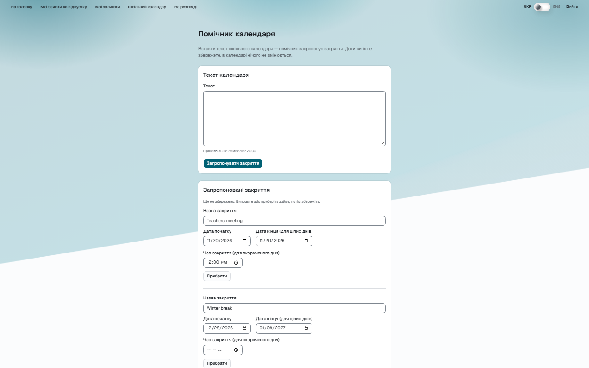
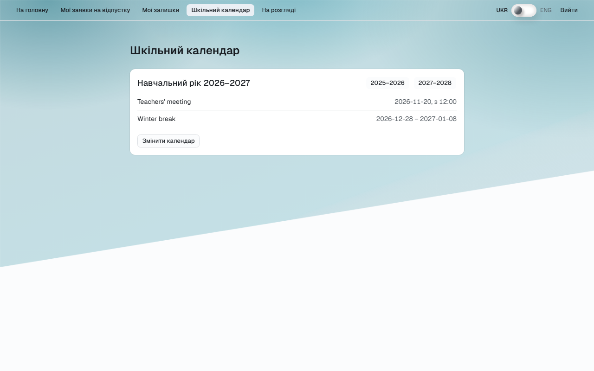
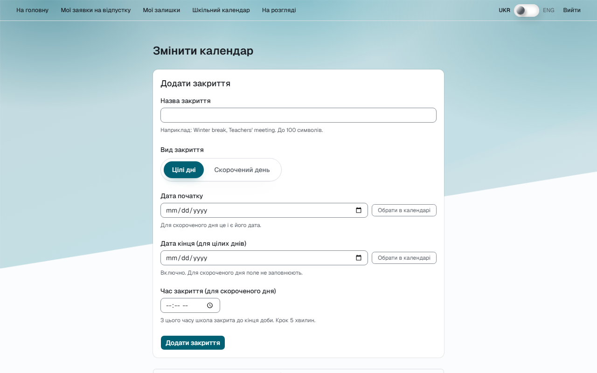
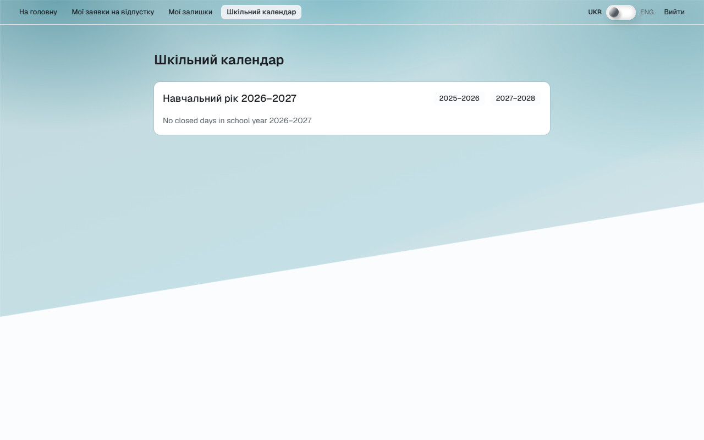
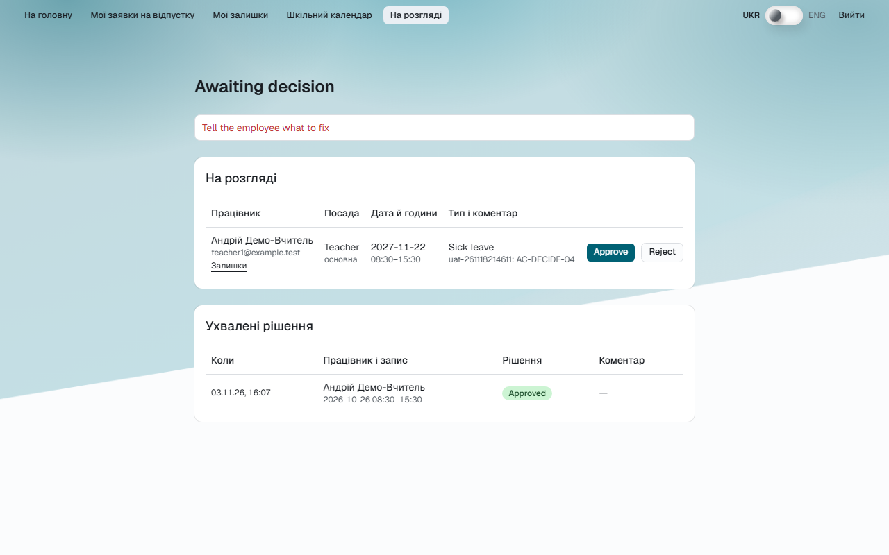

# Звіт UAT — 18.11.2026

- **Застосунок:** https://course-staff-management.vercel.app (/api/health: коміт `5ebe8cc`)
- **Код тестів:** `task/assistant-uat` @ `f0792bb`
- **Прогін:** 18.11.2026, 23:46 (Київ), Playwright 123.3 с; AC: 11 — PASS 9, FAIL 0, NEEDS-HUMAN 2
- **Рецензент:** `claude-haiku-5-5`; суперечки → `claude-sonnet-5-5`. Разом за розбір: $0.0951 (ціни API; за підпискою — у межах ліміту плану)
- **Прибирання:** синтетичних uat-*@example.test видалено 0, лишилось 0, їхніх рядків, що лишились: 0
- **Відео й траси:** не в git — `test-results/` локально або артефакт CI; трасу відкриває `npx playwright show-trace <trace.zip>`

| AC | Перевірки | Агент | Підсумок | Чому | Playwright | Розбір |
|---|---|---|---|---|---|---|
| AC-ASSIST-01 | пройшли | Haiku: NEEDS-HUMAN, Sonnet: NEEDS-HUMAN | **NEEDS-HUMAN** | R3: перевірки пройшли, агент не погоджується — вирішує людина | 20.4 с | $0.0416, 26.8 с |
| AC-ASSIST-02 | пройшли | Haiku: PASS | **PASS** | R6: перевірки, агент і цитати збігаються | 19.5 с | $0.0025, 9.7 с |
| AC-ASSIST-11 | пройшли | Haiku: PASS | **PASS** | R6: перевірки, агент і цитати збігаються | 5.8 с | $0.0021, 6.5 с |
| AC-BALANCE-13 | пройшли | Haiku: PASS | **PASS** | R6: перевірки, агент і цитати збігаються | 7.1 с | $0.0022, 6.4 с |
| AC-CAL-02 | пройшли | Haiku: PASS | **PASS** | R6: перевірки, агент і цитати збігаються | 6.8 с | $0.0026, 11.0 с |
| AC-CAL-09 | пройшли | Haiku: NEEDS-HUMAN, Sonnet: NEEDS-HUMAN | **NEEDS-HUMAN** | R3: перевірки пройшли, агент не погоджується — вирішує людина | 6.0 с | $0.0336, 18.5 с |
| AC-CAL-12 | пройшли | Haiku: PASS | **PASS** | R6: перевірки, агент і цитати збігаються | 6.4 с | $0.0019, 6.5 с |
| AC-CAL-14 | пройшли | Haiku: PASS | **PASS** | R6: перевірки, агент і цитати збігаються | 3.3 с | $0.0022, 6.3 с |
| AC-CAL-15 | пройшли | Haiku: PASS | **PASS** | R6: перевірки, агент і цитати збігаються | 6.0 с | $0.0022, 6.2 с |
| AC-DECIDE-04 | пройшли | Haiku: PASS | **PASS** | R6: перевірки, агент і цитати збігаються | 11.0 с | $0.0022, 7.2 с |
| AC-DECIDE-14 | пройшли | Haiku: PASS | **PASS** | R6: перевірки, агент і цитати збігаються | 6.6 с | $0.0021, 6.3 с |

## AC-ASSIST-01 — NEEDS-HUMAN

**Тест:** AC-ASSIST-01: помічник пропонує два закриття, і календар лишається без змін

**Критерій** (requirements/05-calendar-assistant.md):

> AC-ASSIST-01: Given today is Friday 2026-11-13 and the school calendar has no closures. When the administrator asks the calendar assistant for suggestions for the text "Winter break 28.12–08.01; Teachers' meeting 20.11 from 12:00". Then the administrator sees 2 suggested closures — "Winter break" whole days 2026-12-28 – 2027-01-08 and "Teachers' meeting" early dismissal on 2026-11-20 from 12:00 — and the school calendar still has no closures.

**Кроки:** ✔ Дано: шкільний календар не має жодного закриття → ✔ Коли: адміністратор просить помічника про пропозиції для тексту календаря → ✔ Тоді: the administrator sees 2 suggested closures — "Winter break" whole days 2026-12-28 – 2027-01-08 and "Teachers' meeting" early dismissal on 2026-11-20 from 12:00 — and the school calendar still has no closures.

**Агент (claude-sonnet-5-5, NEEDS-HUMAN):** На кадрі дві картки закриттів: «Teachers' meeting» (11/20/2026, 12:00 PM) і «Winter break» (12/28/2026 – 01/08/2027, час порожній), а також підпис «Ще не збережено…». Дати відображені в локальному форматі поля вводу, тому суворої посимвольної відповідності критерію немає — потрібна людина, щоб вирішити, чи це прийнятно.

Haiku сказав NEEDS-HUMAN, тож розбір повторив Sonnet; рішення агента — за Sonnet.

**Агент бачить вади:**
- Дати на кадрі показано у форматі MM/DD/YYYY (11/20/2026, 12/28/2026, 01/08/2027), а не 2026-11-20 / 2026-12-28 / 2027-01-08 як у критерії; посимвольно не збігається.
- Час показано як «12:00 PM», у критерії «12:00».

**Цитати агента, звірені зі сторінкою (aria):**
- «Teachers' meeting» — є на сторінці
- «Winter break» — є на сторінці
- «Ще не збережено. Виправте або приберіть зайве, потім збережте.» — НЕМАЄ на сторінці

**Правило:** R3: перевірки пройшли, агент не погоджується — вирішує людина

**Відео:** `test-results/artifacts/assistant-live-помічник-ка-193e0-календар-лишається-без-змін-chromium/video-1.webm` · **траса:** `test-results/artifacts/assistant-live-помічник-ка-193e0-календар-лишається-без-змін-chromium/trace.zip` (не в git)

**Рішення PM:** ☐ приймаю · ☐ відхилення від вимог (issue «Відхилення від вимог: AC-ASSIST-01 — …») · @login: ____

## AC-ASSIST-02 — PASS

**Тест:** AC-ASSIST-02: збережені без змін пропозиції потрапляють у шкільний календар

**Критерій** (requirements/05-calendar-assistant.md):

> AC-ASSIST-02: Given the 2 suggested closures from AC-ASSIST-01. When the administrator saves them without changes. Then the school calendar shows "Teachers' meeting" on 2026-11-20 from 12:00 and "Winter break" 2026-12-28 – 2027-01-08.

**Кроки:** ✔ Дано: адміністратор має дві запропоновані позиції з тексту календаря → ✔ Коли: адміністратор зберігає їх без змін → ✔ Тоді: the school calendar shows "Teachers' meeting" on 2026-11-20 from 12:00 and "Winter break" 2026-12-28 – 2027-01-08.

**Агент (claude-haiku-5-5, PASS):** На кадрі сторінка «Шкільний календар» (українська локаль, UKR увімкнено) з двома рядками: «Teachers' meeting» із датою 2026-11-20 і часом 12:00 та «Winter break» із датами 2026-12-28 – 2027-01-08. Час на екрані показано як «з 12:00» — це український переклад слова «from» з критерію, а не дослівне повторення; дата, час і назви збігаються за змістом. Частини, що мають цитувати текст, відповідають критерію.

**Цитати агента, звірені зі сторінкою (aria):**
- «Teachers' meeting» — є на сторінці
- «2026-11-20, з 12:00» — є на сторінці
- «Winter break» — є на сторінці
- «2026-12-28 – 2027-01-08» — є на сторінці

**Правило:** R6: перевірки, агент і цитати збігаються

**Відео:** `test-results/artifacts/assistant-live-помічник-ка-3ef59-апляють-у-шкільний-календар-chromium/video.webm` · **траса:** `test-results/artifacts/assistant-live-помічник-ка-3ef59-апляють-у-шкільний-календар-chromium/trace.zip` (не в git)

**Рішення PM:** ☐ приймаю · ☐ відхилення від вимог (issue «Відхилення від вимог: AC-ASSIST-02 — …») · @login: ____

## AC-ASSIST-11 — PASS

**Тест:** AC-ASSIST-11: працівник за прямим посиланням бачить відмову й жодного поля

**Критерій** (requirements/05-calendar-assistant.md):

> AC-ASSIST-11: Given teacher1@example.test is signed in and has only the employee role. When teacher1@example.test opens the calendar assistant by a direct link. Then teacher1@example.test sees the message "Only an administrator can change the school calendar", and no closures are suggested or saved.

**Кроки:** ✔ Дано: працівник teacher1@example.test — у порталі, має лише роль працівника → ✔ Коли: відкриває помічника календаря за прямим посиланням → ✔ Тоді: teacher1@example.test sees the message "Only an administrator can change the school calendar", and no closures are suggested or saved.

**Агент (claude-haiku-5-5, PASS):** На кадрі сторінки «Помічник календаря» видно червоний напис у білому полі: «Only an administrator can change the school calendar». Текст збігається з критерієм посимвольно. Поле календаря, кнопка пропозицій і відсутність закриттів не оцінювалися, бо це частини «Не з кадрів».

**Цитати агента, звірені зі сторінкою (aria):**
- «Only an administrator can change the school calendar» — є на сторінці

**Правило:** R6: перевірки, агент і цитати збігаються

**Відео:** `test-results/artifacts/assistant-помічник-календа-a8765-чить-відмову-й-жодного-поля-chromium/video.webm` · **траса:** `test-results/artifacts/assistant-помічник-календа-a8765-чить-відмову-й-жодного-поля-chromium/trace.zip` (не в git)

**Рішення PM:** ☐ приймаю · ☐ відхилення від вимог (issue «Відхилення від вимог: AC-ASSIST-11 — …») · @login: ____

## AC-BALANCE-13 — PASS

**Тест:** AC-BALANCE-13: працівник відкриває чужі залишки за прямим посиланням — чисел не бачить

**Критерій** (requirements/03-leave-balance.md):

> AC-BALANCE-13: Given employee teacher1@example.test. When teacher1@example.test tries to view another employee's balances. Then the balances are not shown.

**Кроки:** ✔ Дано: працівник teacher1@example.test — у порталі, і він не менеджер жодної посади teacher2@example.test → ✔ Коли: відкриває сторінку залишків іншого працівника за її адресою → ✔ Тоді: the balances are not shown.

**Агент (claude-haiku-5-5, PASS):** На кадрі видно заголовок «Залишки працівника» і червоне повідомлення в білій рамці з текстом, що збігається з критерієм посимвольно. Таблиці залишків на кадрі немає, чисел і чужої адреси теж немає. Це узгоджується з тим, що залишки не показані.

**Цитати агента, звірені зі сторінкою (aria):**
- «Залишки працівника» — є на сторінці
- «Залишки працівника бачить він сам, відповідальний менеджер будь-якої його посади й адміністратор.» — є на сторінці

**Правило:** R6: перевірки, агент і цитати збігаються

**Відео:** `test-results/artifacts/balances-forbidden-AC-BALA-48372-осиланням-—-чисел-не-бачить-chromium/video.webm` · **траса:** `test-results/artifacts/balances-forbidden-AC-BALA-48372-осиланням-—-чисел-не-бачить-chromium/trace.zip` (не в git)

**Рішення PM:** ☐ приймаю · ☐ відхилення від вимог (issue «Відхилення від вимог: AC-BALANCE-13 — …») · @login: ____

## AC-CAL-02 — PASS

**Тест:** AC-CAL-02: працівник бачить пункт «Шкільний календар» у шапці

**Критерій** (requirements/04-school-calendar.md):

> AC-CAL-02: Given the administrator added "Winter break" 2026-12-28 – 2027-01-08. When teacher1@example.test opens the school calendar. Then teacher1@example.test sees "Winter break" with the dates 2026-12-28 – 2027-01-08.

**Кроки:** ✔ Дано: працівник teacher1@example.test — у порталі → ✔ Коли: дивиться на головну навігацію → ✔ Тоді: every signed-in user can see the school calendar.

**Агент (claude-haiku-5-5, PASS):** На кадрі видно верхню навігацію з пунктом «Шкільний календар», він підсвічений як поточна сторінка, а сторінка має заголовок «Шкільний календар» — це узгоджується з /calendar. Окремо: у картці «Навчальний рік 2026–2027» написано «No closed days in school year 2026–2027», а «Winter break» з датами на кадрі немає, тому варто перевірити людиною, чи канікули мали відобразитися на цьому екрані.

**Агент бачить вади:**
- На кадрі немає тексту «Winter break» і дат 2026-12-28 – 2027-01-08. Натомість картка під заголовком «Шкільний календар» показує «No closed days in school year 2026–2027». Це не входить до переліку видимих частин «Тоді» в ac.md, тож на вердикт не впливає, але основна вимога критерію на цьому кадрі не підтверджена.

**Цитати агента, звірені зі сторінкою (aria):**
- «Шкільний календар» — є на сторінці

**Правило:** R6: перевірки, агент і цитати збігаються

**Відео:** `test-results/artifacts/calendar-календар-для-авто-26a96-«Шкільний-календар»-у-шапці-chromium/video.webm` · **траса:** `test-results/artifacts/calendar-календар-для-авто-26a96-«Шкільний-календар»-у-шапці-chromium/trace.zip` (не в git)

**Рішення PM:** ☐ приймаю · ☐ відхилення від вимог (issue «Відхилення від вимог: AC-CAL-02 — …») · @login: ____

## AC-CAL-09 — NEEDS-HUMAN

**Тест:** AC-CAL-09: адміністратор бачить форму додавання й перелік закриттів

**Критерій** (requirements/04-school-calendar.md):

> AC-CAL-09: Given "Winter break" 2026-12-28 – 2027-01-08 and an employee with the schedule Mon–Fri 08:30–15:30. When the administrator removes "Winter break" and the employee then chooses Tuesday 2026-12-29 in a new request. Then the school calendar no longer shows "Winter break", and 2026-12-29 is accepted with the hours 08:30–15:30.

**Кроки:** ✔ Дано: адміністратор admin@example.test — у порталі → ✔ Коли: переходить до зміни шкільного календаря → ✔ Тоді: closures are created by the administrator in the portal.

**Агент (claude-sonnet-5-5, NEEDS-HUMAN):** На кадрі сторінка «Змінити календар» з формою «Додати закриття»: назва, вид закриття, дата початку, дата кінця, час закриття та кнопка «Додати закриття». Розділ наявних закриттів не видно, бо внизу кадру лише верхній край наступної картки без тексту.

Haiku сказав NEEDS-HUMAN, тож розбір повторив Sonnet; рішення агента — за Sonnet.

**Агент бачить вади:**
- Кадр обрізаний знизу: видно лише верхній край наступної картки, без заголовка чи тексту, тому розділ наявних закриттів підтвердити неможливо.

**Цитати агента, звірені зі сторінкою (aria):**
- «Додати закриття» — є на сторінці
- «Назва закриття» — є на сторінці
- «Вид закриття» — є на сторінці
- «Дата початку» — є на сторінці
- «Дата кінця (для цілих днів)» — є на сторінці
- «Час закриття (для скороченого дня)» — є на сторінці

**Правило:** R3: перевірки пройшли, агент не погоджується — вирішує людина

**Відео:** `test-results/artifacts/calendar-адміністратор-від-98dbf-давання-й-перелік-закриттів-chromium/video.webm` · **траса:** `test-results/artifacts/calendar-адміністратор-від-98dbf-давання-й-перелік-закриттів-chromium/trace.zip` (не в git)

**Рішення PM:** ☐ приймаю · ☐ відхилення від вимог (issue «Відхилення від вимог: AC-CAL-09 — …») · @login: ____

## AC-CAL-12 — PASS

**Тест:** AC-CAL-12: працівник за прямим посиланням бачить відмову

**Критерій** (requirements/04-school-calendar.md):

> AC-CAL-12: Given teacher1@example.test is signed in and has only the employee role. When teacher1@example.test opens the page for changing the school calendar by a direct link. Then teacher1@example.test sees the message "Only an administrator can change the school calendar", and the school calendar is unchanged.

**Кроки:** ✔ Дано: працівник teacher1@example.test — у порталі й не є адміністратором → ✔ Коли: відкриває сторінку зміни шкільного календаря за прямим посиланням → ✔ Тоді: teacher1@example.test sees the message "Only an administrator can change the school calendar", and the school calendar is unchanged.

**Агент (claude-haiku-5-5, PASS):** На кадрі сторінка «Змінити календар» (шапка з пунктом «Шкільний календар») містить червоний напис «Only an administrator can change the school calendar», який збігається з критерієм посимвольно. Форми закриттів на кадрі не видно, тому цю частину не оцінюю; «календар не змінився» кадр не показує і в списку видимих частин її немає.

**Цитати агента, звірені зі сторінкою (aria):**
- «Only an administrator can change the school calendar» — є на сторінці

**Правило:** R6: перевірки, агент і цитати збігаються

**Відео:** `test-results/artifacts/calendar-зміна-календаря-—-5955c-м-посиланням-бачить-відмову-chromium/video.webm` · **траса:** `test-results/artifacts/calendar-зміна-календаря-—-5955c-м-посиланням-бачить-відмову-chromium/trace.zip` (не в git)

**Рішення PM:** ☐ приймаю · ☐ відхилення від вимог (issue «Відхилення від вимог: AC-CAL-12 — …») · @login: ____

## AC-CAL-14 — PASS

**Тест:** AC-CAL-14: відвідувач без входу бачить сторінку входу й жодної назви закриття

**Критерій** (requirements/04-school-calendar.md):

> AC-CAL-14: Given nobody is signed in. When a visitor opens the school calendar by a direct link. Then the visitor sees the sign-in page, and no closure names or dates are shown.

**Кроки:** ✔ Дано: ніхто не увійшов → ✔ Коли: відвідувач відкриває шкільний календар за прямим посиланням → ✔ Тоді: the visitor sees the sign-in page, and no closure names or dates are shown.

**Агент (claude-haiku-5-5, PASS):** На кадрі frame-then-1.png видно сторінку входу: заголовок «Вхід», поля «Email» і «Пароль», кнопка «Увійти». Жодної назви чи дати закриття на кадрі немає, але за правилами це не оцінюється; адресу в адресному рядку на кадрі не видно, тож /login не підтверджено кадром.

**Цитати агента, звірені зі сторінкою (aria):**
- «Вхід» — є на сторінці
- «Email» — є на сторінці
- «Пароль» — є на сторінці
- «Увійти» — є на сторінці

**Правило:** R6: перевірки, агент і цитати збігаються

**Відео:** `test-results/artifacts/calendar-календар-для-неав-2d8fc-оду-й-жодної-назви-закриття-chromium/video.webm` · **траса:** `test-results/artifacts/calendar-календар-для-неав-2d8fc-оду-й-жодної-назви-закриття-chromium/trace.zip` (не в git)

**Рішення PM:** ☐ приймаю · ☐ відхилення від вимог (issue «Відхилення від вимог: AC-CAL-14 — …») · @login: ____

## AC-CAL-15 — PASS

**Тест:** AC-CAL-15: рік без закриттів показує «No closed days in school year 2026–2027»

**Критерій** (requirements/04-school-calendar.md):

> AC-CAL-15: Given the school calendar has no closures in school year 2026–2027. When an employee opens the school calendar for school year 2026–2027. Then the employee sees the message "No closed days in school year 2026–2027".

**Кроки:** ✔ Дано: працівник teacher1@example.test — у порталі → ✔ Коли: відкриває шкільний календар за навчальний рік 2026–2027 → ✔ Тоді: the employee sees the message "No closed days in school year 2026–2027".

**Агент (claude-haiku-5-5, PASS):** На кадрі /calendar заголовок «Шкільний календар» і під карткою «Навчальний рік 2026–2027» написаний текст «No closed days in school year 2026–2027». Рядків із закриттями на кадрі немає, що узгоджується з умовою. Текст читабельний, тире між роками виглядає як у критерії.

**Цитати агента, звірені зі сторінкою (aria):**
- «Шкільний календар» — є на сторінці
- «No closed days in school year 2026–2027» — є на сторінці

**Правило:** R6: перевірки, агент і цитати збігаються

**Відео:** `test-results/artifacts/calendar-календар-для-авто-2d971-s-in-school-year-2026–2027»-chromium/video.webm` · **траса:** `test-results/artifacts/calendar-календар-для-авто-2d971-s-in-school-year-2026–2027»-chromium/trace.zip` (не в git)

**Рішення PM:** ☐ приймаю · ☐ відхилення від вимог (issue «Відхилення від вимог: AC-CAL-15 — …») · @login: ____

## AC-DECIDE-04 — PASS

**Тест:** AC-DECIDE-04: менеджер повертає запис без коментаря — статус не змінюється, видно «Tell the employee what to fix»

**Критерій** (requirements/02-leave-decision.md):

> AC-DECIDE-04: Given a record with status "Awaiting decision". When the manager returns it for revision without a comment. Then the status does not change, and the manager sees the message "Tell the employee what to fix".

**Кроки:** ✔ Дано: у менеджера manager1@example.test є запис зі статусом «Awaiting decision» → ✔ Коли: він повертає запис на доопрацювання, лишивши коментар порожнім → ✔ Тоді: the status does not change, and the manager sees the message "Tell the employee what to fix".

**Агент (claude-haiku-5-5, PASS):** На кадрі над списком видно червоний напис «Tell the employee what to fix», а в таблиці «На розгляді» під заголовком «Awaiting decision» лишився запис Sick leave з датою 2027-11-22 і кнопками Approve/Reject. Позначки «Returned for revision» на кадрі немає, але за правилами це не оцінюється.

**Цитати агента, звірені зі сторінкою (aria):**
- «Tell the employee what to fix» — є на сторінці
- «Awaiting decision» — є на сторінці
- «2027-11-22» — є на сторінці

**Правило:** R6: перевірки, агент і цитати збігаються

**Відео:** `test-results/artifacts/decisions-return-no-commen-942cb-l-the-employee-what-to-fix»-chromium/video.webm` · **траса:** `test-results/artifacts/decisions-return-no-commen-942cb-l-the-employee-what-to-fix»-chromium/trace.zip` (не в git)

**Рішення PM:** ☐ приймаю · ☐ відхилення від вимог (issue «Відхилення від вимог: AC-DECIDE-04 — …») · @login: ____

## AC-DECIDE-14 — PASS

**Тест:** AC-DECIDE-14: менеджер без записів на розгляді бачить «No records awaiting decision»

**Критерій** (requirements/02-leave-decision.md):

> AC-DECIDE-14: Given the manager has 0 records with status "Awaiting decision". When the manager opens the "Awaiting decision" list. Then the manager sees the message "No records awaiting decision".

**Кроки:** ✔ Дано: менеджер manager2@example.test — у порталі, записів на розгляді в нього немає → ✔ Коли: відкриває список «Awaiting decision» → ✔ Тоді: the manager sees the message "No records awaiting decision".

**Агент (claude-haiku-5-5, PASS):** На кадрі frame-then-1.png (сторінка /decisions) видно заголовок «Awaiting decision» і повідомлення «No records awaiting decision» у картці «На розгляді». Обидві видимі частини «Тоді» збігаються з критерієм посимвольно. Рядків із записами та кнопок рішення на кадрі немає, що відповідає очікуванню.

**Цитати агента, звірені зі сторінкою (aria):**
- «Awaiting decision» — є на сторінці
- «No records awaiting decision» — є на сторінці

**Правило:** R6: перевірки, агент і цитати збігаються

**Відео:** `test-results/artifacts/decisions-empty-AC-DECIDE--62fd7--records-awaiting-decision»-chromium/video.webm` · **траса:** `test-results/artifacts/decisions-empty-AC-DECIDE--62fd7--records-awaiting-decision»-chromium/trace.zip` (не в git)

**Рішення PM:** ☐ приймаю · ☐ відхилення від вимог (issue «Відхилення від вимог: AC-DECIDE-14 — …») · @login: ____

## Як читати підсумок

- **PASS** — автоматичні перевірки пройшли, агент-рецензент погодився з кадром, а кожну його цитату знайдено на сторінці.
- **FAIL** — впала автоматична перевірка. Агент цього не перекриває: невидимі вади (буфер обміну, база) він на кадрі не побачить.
- **NEEDS-HUMAN** — перевірки зелені, але агент не погодився або його цитати немає на сторінці. Часто це слабкий тест або розбіжність між текстом AC і тестом — питання до PM, а не обов'язково вада продукту.

Правила: R1: перевірка впала — FAIL завжди, агент не перекриває; R2: немає вердикту агента або кадру; R3: перевірки пройшли, агент не погоджується — вирішує людина; R4: цитати агента немає на сторінці (aria) — не підтверджено; R5: помилка сторінки або 5xx під час сценарію; R6: перевірки, агент і цитати збігаються.
