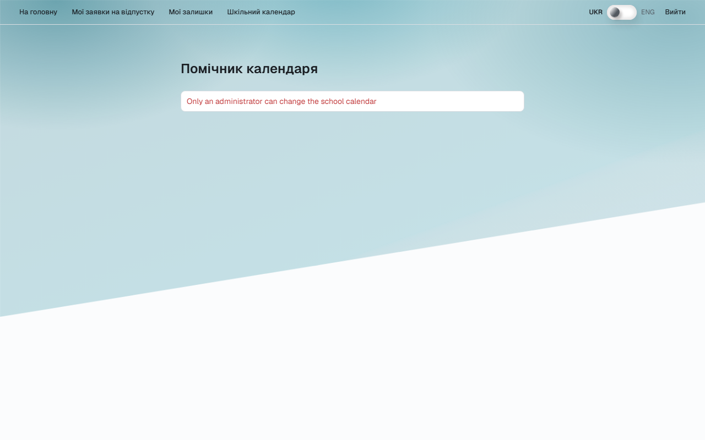
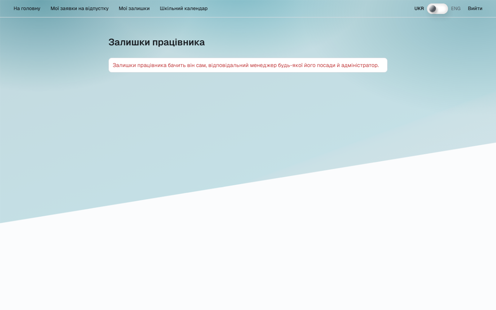
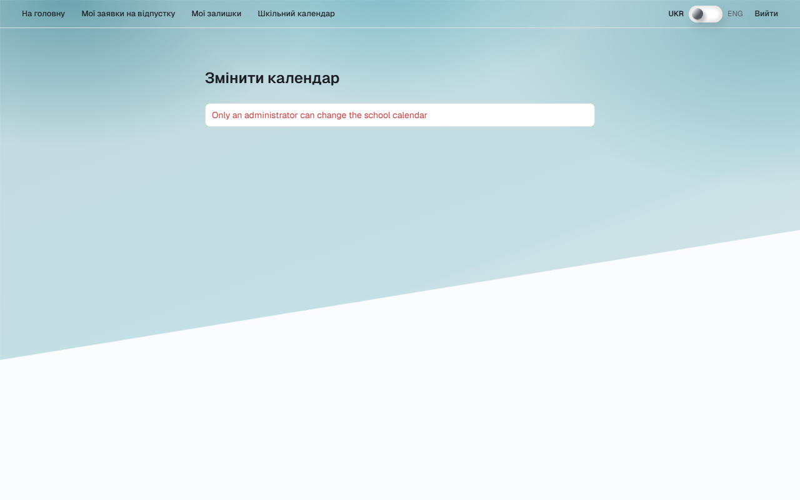
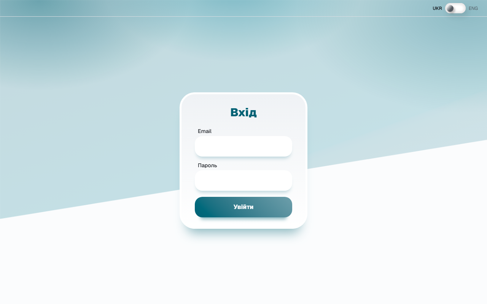
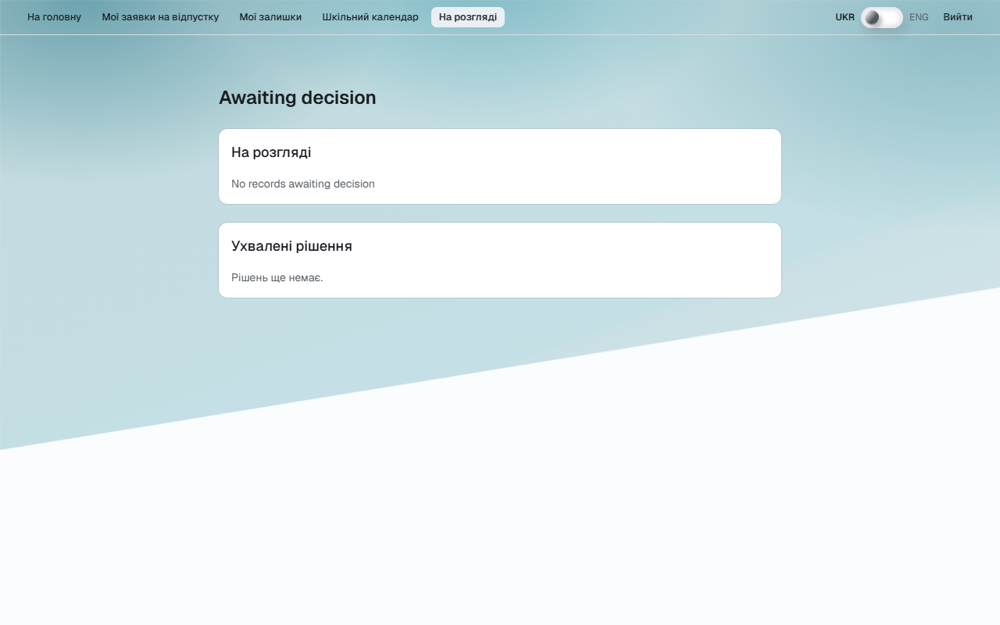

# Звіт UAT — 18.11.2026

- **Застосунок:** https://course-staff-management.vercel.app (/api/health: коміт `5ebe8cc`)
- **Код тестів:** `task/assistant-uat` @ `dd8127d` + незакомічені зміни
- **Прогін:** 18.11.2026, 23:37 (Київ), Playwright 121.4 с; AC: 11 — PASS 0, FAIL 0, NEEDS-HUMAN 11
- **Рецензент:** `claude-haiku-5-5`; суперечки → `claude-sonnet-5-5`. Разом за розбір: $0.3288 (ціни API; за підпискою — у межах ліміту плану)
- **Прибирання:** синтетичних uat-*@example.test видалено 0, лишилось 0, їхніх рядків, що лишились: 0
- **Відео й траси:** не в git — `test-results/` локально або артефакт CI; трасу відкриває `npx playwright show-trace <trace.zip>`

| AC | Перевірки | Агент | Підсумок | Чому | Playwright | Розбір |
|---|---|---|---|---|---|---|
| AC-ASSIST-01 | пройшли | Haiku: NEEDS-HUMAN, Sonnet: NEEDS-HUMAN | **NEEDS-HUMAN** | R3: перевірки пройшли, агент не погоджується — вирішує людина | 19.7 с | $0.0357, 20.4 с |
| AC-ASSIST-02 | пройшли | Haiku: NEEDS-HUMAN, Sonnet: NEEDS-HUMAN | **NEEDS-HUMAN** | R3: перевірки пройшли, агент не погоджується — вирішує людина | 18.6 с | $0.0370, 18.8 с |
| AC-ASSIST-11 | пройшли | Haiku: NEEDS-HUMAN, Sonnet: NEEDS-HUMAN | **NEEDS-HUMAN** | R3: перевірки пройшли, агент не погоджується — вирішує людина | 5.8 с | $0.0424, 20.3 с |
| AC-BALANCE-13 | пройшли | Haiku: NEEDS-HUMAN, Sonnet: NEEDS-HUMAN | **NEEDS-HUMAN** | R3: перевірки пройшли, агент не погоджується — вирішує людина | 6.7 с | $0.0261, 16.7 с |
| AC-CAL-02 | пройшли | Haiku: NEEDS-HUMAN, Sonnet: NEEDS-HUMAN | **NEEDS-HUMAN** | R3: перевірки пройшли, агент не погоджується — вирішує людина | 7.3 с | $0.0264, 14.9 с |
| AC-CAL-09 | пройшли | Haiku: NEEDS-HUMAN, Sonnet: NEEDS-HUMAN | **NEEDS-HUMAN** | R3: перевірки пройшли, агент не погоджується — вирішує людина | 5.8 с | $0.0279, 16.7 с |
| AC-CAL-12 | пройшли | Haiku: NEEDS-HUMAN, Sonnet: NEEDS-HUMAN | **NEEDS-HUMAN** | R3: перевірки пройшли, агент не погоджується — вирішує людина | 6.5 с | $0.0252, 15.7 с |
| AC-CAL-14 | пройшли | Haiku: NEEDS-HUMAN, Sonnet: NEEDS-HUMAN | **NEEDS-HUMAN** | R3: перевірки пройшли, агент не погоджується — вирішує людина | 3.5 с | $0.0265, 15.3 с |
| AC-CAL-15 | пройшли | Haiku: NEEDS-HUMAN, Sonnet: NEEDS-HUMAN | **NEEDS-HUMAN** | R3: перевірки пройшли, агент не погоджується — вирішує людина | 7.2 с | $0.0275, 16.8 с |
| AC-DECIDE-04 | пройшли | Haiku: NEEDS-HUMAN, Sonnet: NEEDS-HUMAN | **NEEDS-HUMAN** | R3: перевірки пройшли, агент не погоджується — вирішує людина | 10.2 с | $0.0273, 19.1 с |
| AC-DECIDE-14 | пройшли | Haiku: NEEDS-HUMAN, Sonnet: NEEDS-HUMAN | **NEEDS-HUMAN** | R3: перевірки пройшли, агент не погоджується — вирішує людина | 6.4 с | $0.0268, 17.0 с |

## AC-ASSIST-01 — NEEDS-HUMAN

**Тест:** AC-ASSIST-01: помічник пропонує два закриття, і календар лишається без змін

**Критерій** (requirements/05-calendar-assistant.md):

> AC-ASSIST-01: Given today is Friday 2026-11-13 and the school calendar has no closures. When the administrator asks the calendar assistant for suggestions for the text "Winter break 28.12–08.01; Teachers' meeting 20.11 from 12:00". Then the administrator sees 2 suggested closures — "Winter break" whole days 2026-12-28 – 2027-01-08 and "Teachers' meeting" early dismissal on 2026-11-20 from 12:00 — and the school calendar still has no closures.

**Кроки:** ✔ Дано: шкільний календар не має жодного закриття → ✔ Коли: адміністратор просить помічника про пропозиції для тексту календаря → ✔ Тоді: the administrator sees 2 suggested closures — "Winter break" whole days 2026-12-28 – 2027-01-08 and "Teachers' meeting" early dismissal on 2026-11-20 from 12:00 — and the school calendar still has no closures.

**Агент (claude-sonnet-5-5, NEEDS-HUMAN):** Файли критерію та журналу не вдалося прочитати: Read відхилив виклики через підозрілий шаблон шляху Windows, а підтвердити було нікому. Кадрів я не бачив, тому оцінити частини «Тоді» неможливо. Потрібен ручний перегляд або повторний запуск зі шляхом, який не потребує підтвердження.

Haiku сказав NEEDS-HUMAN, тож розбір повторив Sonnet; рішення агента — за Sonnet.

**Агент бачить вади:**
- Доступ до ac.md і journey.md заборонено системою дозволів (шлях зі скороченим ім'ям Windows DEVELO~1), кадри не переглянуто.

**Правило:** R3: перевірки пройшли, агент не погоджується — вирішує людина

**Відео:** `test-results/artifacts/assistant-live-помічник-ка-193e0-календар-лишається-без-змін-chromium/video-1.webm` · **траса:** `test-results/artifacts/assistant-live-помічник-ка-193e0-календар-лишається-без-змін-chromium/trace.zip` (не в git)

**Рішення PM:** ☐ приймаю · ☐ відхилення від вимог (issue «Відхилення від вимог: AC-ASSIST-01 — …») · @login: ____

## AC-ASSIST-02 — NEEDS-HUMAN

**Тест:** AC-ASSIST-02: збережені без змін пропозиції потрапляють у шкільний календар

**Критерій** (requirements/05-calendar-assistant.md):

> AC-ASSIST-02: Given the 2 suggested closures from AC-ASSIST-01. When the administrator saves them without changes. Then the school calendar shows "Teachers' meeting" on 2026-11-20 from 12:00 and "Winter break" 2026-12-28 – 2027-01-08.

**Кроки:** ✔ Дано: адміністратор має дві запропоновані позиції з тексту календаря → ✔ Коли: адміністратор зберігає їх без змін → ✔ Тоді: the school calendar shows "Teachers' meeting" on 2026-11-20 from 12:00 and "Winter break" 2026-12-28 – 2027-01-08.

**Агент (claude-sonnet-5-5, NEEDS-HUMAN):** Жодного файлу прочитати не вдалося, тому кадри не оцінено. Потрібен повторний запуск зі шляхом без скороченого імені (наприклад, C:\Users\Developer\...) або з наданим дозволом на читання.

Haiku сказав NEEDS-HUMAN, тож розбір повторив Sonnet; рішення агента — за Sonnet.

**Агент бачить вади:**
- Читання ac.md і journey.md заблоковано: шлях із коротким ім'ям Windows (DEVELO~1) вимагає ручного підтвердження, а в сесії немає способу його надати.
- Кадри frame-then-*.png не переглядалися, бо без ac.md невідомо, які частини «Тоді» перевіряти.

**Правило:** R3: перевірки пройшли, агент не погоджується — вирішує людина

**Відео:** `test-results/artifacts/assistant-live-помічник-ка-3ef59-апляють-у-шкільний-календар-chromium/video.webm` · **траса:** `test-results/artifacts/assistant-live-помічник-ка-3ef59-апляють-у-шкільний-календар-chromium/trace.zip` (не в git)

**Рішення PM:** ☐ приймаю · ☐ відхилення від вимог (issue «Відхилення від вимог: AC-ASSIST-02 — …») · @login: ____

## AC-ASSIST-11 — NEEDS-HUMAN

**Тест:** AC-ASSIST-11: працівник за прямим посиланням бачить відмову й жодного поля

**Критерій** (requirements/05-calendar-assistant.md):

> AC-ASSIST-11: Given teacher1@example.test is signed in and has only the employee role. When teacher1@example.test opens the calendar assistant by a direct link. Then teacher1@example.test sees the message "Only an administrator can change the school calendar", and no closures are suggested or saved.

**Кроки:** ✔ Дано: працівник teacher1@example.test — у порталі, має лише роль працівника → ✔ Коли: відкриває помічника календаря за прямим посиланням → ✔ Тоді: teacher1@example.test sees the message "Only an administrator can change the school calendar", and no closures are suggested or saved.

**Агент (claude-sonnet-5-5, NEEDS-HUMAN):** Я не бачив ані критерію, ані кадрів, бо інструмент Read відхилив доступ до теки. Судити про результат неможливо, тому потрібна людина або доступ до файлів. ac_id невідомий.

Haiku сказав NEEDS-HUMAN, тож розбір повторив Sonnet; рішення агента — за Sonnet.

**Агент бачить вади:**
- Читання ac.md і journey.md заблоковано дозволами: короткий шлях 8.3 (DEVELO~1) позначено як підозрілий, а повний шлях C:\Users\Developer\... лежить поза дозволеними теками. Кадри frame-then-*.png я не відкривав.

**Правило:** R3: перевірки пройшли, агент не погоджується — вирішує людина

**Відео:** `test-results/artifacts/assistant-помічник-календа-a8765-чить-відмову-й-жодного-поля-chromium/video.webm` · **траса:** `test-results/artifacts/assistant-помічник-календа-a8765-чить-відмову-й-жодного-поля-chromium/trace.zip` (не в git)

**Рішення PM:** ☐ приймаю · ☐ відхилення від вимог (issue «Відхилення від вимог: AC-ASSIST-11 — …») · @login: ____

## AC-BALANCE-13 — NEEDS-HUMAN

**Тест:** AC-BALANCE-13: працівник відкриває чужі залишки за прямим посиланням — чисел не бачить

**Критерій** (requirements/03-leave-balance.md):

> AC-BALANCE-13: Given employee teacher1@example.test. When teacher1@example.test tries to view another employee's balances. Then the balances are not shown.

**Кроки:** ✔ Дано: працівник teacher1@example.test — у порталі, і він не менеджер жодної посади teacher2@example.test → ✔ Коли: відкриває сторінку залишків іншого працівника за її адресою → ✔ Тоді: the balances are not shown.

**Агент (claude-sonnet-5-5, NEEDS-HUMAN):** Я не прочитав жодного файлу: Read відхилили автоматично через підозрілий шаблон шляху (коротке ім'я DEVELO~1). Кадрів я не бачив, тому оцінити частини «Тоді» не можу. Потрібна людина, або перезапуск із дозволом на читання цієї теки.

Haiku сказав NEEDS-HUMAN, тож розбір повторив Sonnet; рішення агента — за Sonnet.

**Агент бачить вади:**
- Доступ до ac.md і journey.md заблоковано: шлях із коротким ім'ям Windows (DEVELO~1) вимагає ручного підтвердження, а підтвердити його ніхто не міг.
- Кадри frame-then-*.png не відкривалися, бо без ac.md невідомо, які саме частини «Тоді» перевіряти.

**Правило:** R3: перевірки пройшли, агент не погоджується — вирішує людина

**Відео:** `test-results/artifacts/balances-forbidden-AC-BALA-48372-осиланням-—-чисел-не-бачить-chromium/video.webm` · **траса:** `test-results/artifacts/balances-forbidden-AC-BALA-48372-осиланням-—-чисел-не-бачить-chromium/trace.zip` (не в git)

**Рішення PM:** ☐ приймаю · ☐ відхилення від вимог (issue «Відхилення від вимог: AC-BALANCE-13 — …») · @login: ____

## AC-CAL-02 — NEEDS-HUMAN

**Тест:** AC-CAL-02: працівник бачить пункт «Шкільний календар» у шапці

**Критерій** (requirements/04-school-calendar.md):

> AC-CAL-02: Given the administrator added "Winter break" 2026-12-28 – 2027-01-08. When teacher1@example.test opens the school calendar. Then teacher1@example.test sees "Winter break" with the dates 2026-12-28 – 2027-01-08.

**Кроки:** ✔ Дано: працівник teacher1@example.test — у порталі → ✔ Коли: дивиться на головну навігацію → ✔ Тоді: every signed-in user can see the school calendar.

**Агент (claude-sonnet-5-5, NEEDS-HUMAN):** Я не прочитав жодного файлу, бо доступ до теки відхилила перевірка дозволів. Жодних кадрів я не бачив, тому оцінити критерій неможливо. Щоб повторити перевірку, потрібен доступ до файлів за повним шляхом без скороченої назви DEVELO~1 або підтверджений дозвіл на читання.

Haiku сказав NEEDS-HUMAN, тож розбір повторив Sonnet; рішення агента — за Sonnet.

**Агент бачить вади:**
- Читання ac.md і journey.md заблоковано: шлях з короткою назвою Windows (DEVELO~1) потребує ручного підтвердження, а в цій сесії його ніхто не може надати.
- Кадри frame-then-*.png не читалися, тому жодної частини «Тоді» не перевірено.

**Правило:** R3: перевірки пройшли, агент не погоджується — вирішує людина

**Відео:** `test-results/artifacts/calendar-календар-для-авто-26a96-«Шкільний-календар»-у-шапці-chromium/video.webm` · **траса:** `test-results/artifacts/calendar-календар-для-авто-26a96-«Шкільний-календар»-у-шапці-chromium/trace.zip` (не в git)

**Рішення PM:** ☐ приймаю · ☐ відхилення від вимог (issue «Відхилення від вимог: AC-CAL-02 — …») · @login: ____

## AC-CAL-09 — NEEDS-HUMAN

**Тест:** AC-CAL-09: адміністратор бачить форму додавання й перелік закриттів

**Критерій** (requirements/04-school-calendar.md):

> AC-CAL-09: Given "Winter break" 2026-12-28 – 2027-01-08 and an employee with the schedule Mon–Fri 08:30–15:30. When the administrator removes "Winter break" and the employee then chooses Tuesday 2026-12-29 in a new request. Then the school calendar no longer shows "Winter break", and 2026-12-29 is accepted with the hours 08:30–15:30.

**Кроки:** ✔ Дано: адміністратор admin@example.test — у порталі → ✔ Коли: переходить до зміни шкільного календаря → ✔ Тоді: closures are created by the administrator in the portal.

**Агент (claude-sonnet-5-5, NEEDS-HUMAN):** Я не прочитав жодного файлу (ac.md, journey.md, кадри), тому перевірити видимий результат неможливо. Потрібен дозвіл на читання теки або повний шлях без короткої назви DEVELO~1.

Haiku сказав NEEDS-HUMAN, тож розбір повторив Sonnet; рішення агента — за Sonnet.

**Агент бачить вади:**
- Доступ до ac.md і journey.md заблоковано: шлях із короткою назвою Windows (DEVELO~1) вимагає ручного підтвердження, а підтвердити нікому.
- Кадри frame-then-*.png не відкривались, критерій приймання не прочитано.

**Правило:** R3: перевірки пройшли, агент не погоджується — вирішує людина

**Відео:** `test-results/artifacts/calendar-адміністратор-від-98dbf-давання-й-перелік-закриттів-chromium/video.webm` · **траса:** `test-results/artifacts/calendar-адміністратор-від-98dbf-давання-й-перелік-закриттів-chromium/trace.zip` (не в git)

**Рішення PM:** ☐ приймаю · ☐ відхилення від вимог (issue «Відхилення від вимог: AC-CAL-09 — …») · @login: ____

## AC-CAL-12 — NEEDS-HUMAN

**Тест:** AC-CAL-12: працівник за прямим посиланням бачить відмову

**Критерій** (requirements/04-school-calendar.md):

> AC-CAL-12: Given teacher1@example.test is signed in and has only the employee role. When teacher1@example.test opens the page for changing the school calendar by a direct link. Then teacher1@example.test sees the message "Only an administrator can change the school calendar", and the school calendar is unchanged.

**Кроки:** ✔ Дано: працівник teacher1@example.test — у порталі й не є адміністратором → ✔ Коли: відкриває сторінку зміни шкільного календаря за прямим посиланням → ✔ Тоді: teacher1@example.test sees the message "Only an administrator can change the school calendar", and the school calendar is unchanged.

**Агент (claude-sonnet-5-5, NEEDS-HUMAN):** Я не бачив ні критерію, ні кадрів, бо доступ до файлів заборонено автоматично. Оцінити частини «Тоді» неможливо, тому потрібна людина або повторний запуск із дозволеним доступом до теки.

Haiku сказав NEEDS-HUMAN, тож розбір повторив Sonnet; рішення агента — за Sonnet.

**Агент бачить вади:**
- Не вдалося прочитати ac.md і journey.md: Read заблоковано (шлях із короткою назвою Windows DEVELO~1 потребує ручного підтвердження, а підтвердити нікому). Кадри frame-then-*.png не відкривались.

**Правило:** R3: перевірки пройшли, агент не погоджується — вирішує людина

**Відео:** `test-results/artifacts/calendar-зміна-календаря-—-5955c-м-посиланням-бачить-відмову-chromium/video.webm` · **траса:** `test-results/artifacts/calendar-зміна-календаря-—-5955c-м-посиланням-бачить-відмову-chromium/trace.zip` (не в git)

**Рішення PM:** ☐ приймаю · ☐ відхилення від вимог (issue «Відхилення від вимог: AC-CAL-12 — …») · @login: ____

## AC-CAL-14 — NEEDS-HUMAN

**Тест:** AC-CAL-14: відвідувач без входу бачить сторінку входу й жодної назви закриття

**Критерій** (requirements/04-school-calendar.md):

> AC-CAL-14: Given nobody is signed in. When a visitor opens the school calendar by a direct link. Then the visitor sees the sign-in page, and no closure names or dates are shown.

**Кроки:** ✔ Дано: ніхто не увійшов → ✔ Коли: відвідувач відкриває шкільний календар за прямим посиланням → ✔ Тоді: the visitor sees the sign-in page, and no closure names or dates are shown.

**Агент (claude-sonnet-5-5, NEEDS-HUMAN):** Я не побачив ні критерію, ні кадрів: доступ до файлів було автоматично відхилено. Оцінити видимі частини «Тоді» неможливо, тому потрібна людина. Повторіть перевірку з дозволом на читання теки або з її повним шляхом без короткої назви.

Haiku сказав NEEDS-HUMAN, тож розбір повторив Sonnet; рішення агента — за Sonnet.

**Агент бачить вади:**
- Читання ac.md і journey.md заблоковано: шлях із короткою назвою Windows (DEVELO~1) потребує ручного підтвердження, а підтвердити його ніхто не може.
- Кадри frame-then-*.png не відкривались, бо без ac.md невідомо, які частини «Тоді» перевіряти.

**Правило:** R3: перевірки пройшли, агент не погоджується — вирішує людина

**Відео:** `test-results/artifacts/calendar-календар-для-неав-2d8fc-оду-й-жодної-назви-закриття-chromium/video.webm` · **траса:** `test-results/artifacts/calendar-календар-для-неав-2d8fc-оду-й-жодної-назви-закриття-chromium/trace.zip` (не в git)

**Рішення PM:** ☐ приймаю · ☐ відхилення від вимог (issue «Відхилення від вимог: AC-CAL-14 — …») · @login: ____

## AC-CAL-15 — NEEDS-HUMAN

**Тест:** AC-CAL-15: рік без закриттів показує «No closed days in school year 2026–2027»

**Критерій** (requirements/04-school-calendar.md):

> AC-CAL-15: Given the school calendar has no closures in school year 2026–2027. When an employee opens the school calendar for school year 2026–2027. Then the employee sees the message "No closed days in school year 2026–2027".

**Кроки:** ✔ Дано: працівник teacher1@example.test — у порталі → ✔ Коли: відкриває шкільний календар за навчальний рік 2026–2027 → ✔ Тоді: the employee sees the message "No closed days in school year 2026–2027".

**Агент (claude-sonnet-5-5, NEEDS-HUMAN):** Файли критерію, журналу й кадрів не були прочитані через відмову в дозволі на шлях, тому я не можу оцінити жодну частину «Тоді». Потрібна ручна перевірка, або повторний запуск із дозволом чи з шляхом без коротких імен.

Haiku сказав NEEDS-HUMAN, тож розбір повторив Sonnet; рішення агента — за Sonnet.

**Агент бачить вади:**
- Доступ до ac.md і journey.md заблоковано: шлях із коротким ім'ям Windows (DEVELO~1) потребує ручного підтвердження, а сесія не має способу його надати.
- Кадри frame-then-*.png не відкривалися, критерій приймання не прочитано.

**Правило:** R3: перевірки пройшли, агент не погоджується — вирішує людина

**Відео:** `test-results/artifacts/calendar-календар-для-авто-2d971-s-in-school-year-2026–2027»-chromium/video.webm` · **траса:** `test-results/artifacts/calendar-календар-для-авто-2d971-s-in-school-year-2026–2027»-chromium/trace.zip` (не в git)

**Рішення PM:** ☐ приймаю · ☐ відхилення від вимог (issue «Відхилення від вимог: AC-CAL-15 — …») · @login: ____

## AC-DECIDE-04 — NEEDS-HUMAN

**Тест:** AC-DECIDE-04: менеджер повертає запис без коментаря — статус не змінюється, видно «Tell the employee what to fix»

**Критерій** (requirements/02-leave-decision.md):

> AC-DECIDE-04: Given a record with status "Awaiting decision". When the manager returns it for revision without a comment. Then the status does not change, and the manager sees the message "Tell the employee what to fix".

**Кроки:** ✔ Дано: у менеджера manager1@example.test є запис зі статусом «Awaiting decision» → ✔ Коли: він повертає запис на доопрацювання, лишивши коментар порожнім → ✔ Тоді: the status does not change, and the manager sees the message "Tell the employee what to fix".

**Агент (claude-sonnet-5-5, NEEDS-HUMAN):** Файли критерію й кроків не вдалося прочитати через відмову дозволу на шлях, тому кадри не оцінено. Потрібна повторна перевірка з доступом до теки або людська оцінка.

Haiku сказав NEEDS-HUMAN, тож розбір повторив Sonnet; рішення агента — за Sonnet.

**Агент бачить вади:**
- Доступ до ac.md і journey.md заблоковано: шлях із коротким ім'ям Windows (DEVELO~1) вимагає ручного підтвердження, а підтвердити нікому.
- Кадри frame-then-*.png не переглянуто, критерій приймання не прочитано.

**Правило:** R3: перевірки пройшли, агент не погоджується — вирішує людина

**Відео:** `test-results/artifacts/decisions-return-no-commen-942cb-l-the-employee-what-to-fix»-chromium/video.webm` · **траса:** `test-results/artifacts/decisions-return-no-commen-942cb-l-the-employee-what-to-fix»-chromium/trace.zip` (не в git)

**Рішення PM:** ☐ приймаю · ☐ відхилення від вимог (issue «Відхилення від вимог: AC-DECIDE-04 — …») · @login: ____

## AC-DECIDE-14 — NEEDS-HUMAN

**Тест:** AC-DECIDE-14: менеджер без записів на розгляді бачить «No records awaiting decision»

**Критерій** (requirements/02-leave-decision.md):

> AC-DECIDE-14: Given the manager has 0 records with status "Awaiting decision". When the manager opens the "Awaiting decision" list. Then the manager sees the message "No records awaiting decision".

**Кроки:** ✔ Дано: менеджер manager2@example.test — у порталі, записів на розгляді в нього немає → ✔ Коли: відкриває список «Awaiting decision» → ✔ Тоді: the manager sees the message "No records awaiting decision".

**Агент (claude-sonnet-5-5, NEEDS-HUMAN):** Файли критерію, журналу й кадрів не вдалося прочитати через відмову в дозволі, тому оцінити видимий результат неможливо. Потрібна ручна перевірка, або повторний запуск із дозволеним доступом до теки.

Haiku сказав NEEDS-HUMAN, тож розбір повторив Sonnet; рішення агента — за Sonnet.

**Агент бачить вади:**
- Доступ до ac.md і journey.md заблокований: шлях містить коротку назву Windows (DEVELO~1), а запит на дозвіл автоматично відхилено.
- Кадри frame-then-*.png не переглядалися, бо після відмови нових спроб я не робив.

**Правило:** R3: перевірки пройшли, агент не погоджується — вирішує людина

**Відео:** `test-results/artifacts/decisions-empty-AC-DECIDE--62fd7--records-awaiting-decision»-chromium/video.webm` · **траса:** `test-results/artifacts/decisions-empty-AC-DECIDE--62fd7--records-awaiting-decision»-chromium/trace.zip` (не в git)

**Рішення PM:** ☐ приймаю · ☐ відхилення від вимог (issue «Відхилення від вимог: AC-DECIDE-14 — …») · @login: ____

## Як читати підсумок

- **PASS** — автоматичні перевірки пройшли, агент-рецензент погодився з кадром, а кожну його цитату знайдено на сторінці.
- **FAIL** — впала автоматична перевірка. Агент цього не перекриває: невидимі вади (буфер обміну, база) він на кадрі не побачить.
- **NEEDS-HUMAN** — перевірки зелені, але агент не погодився або його цитати немає на сторінці. Часто це слабкий тест або розбіжність між текстом AC і тестом — питання до PM, а не обов'язково вада продукту.

Правила: R1: перевірка впала — FAIL завжди, агент не перекриває; R2: немає вердикту агента або кадру; R3: перевірки пройшли, агент не погоджується — вирішує людина; R4: цитати агента немає на сторінці (aria) — не підтверджено; R5: помилка сторінки або 5xx під час сценарію; R6: перевірки, агент і цитати збігаються.
